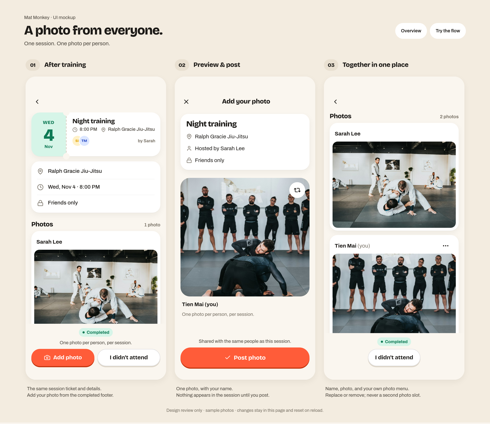

# Participant photos · UI mockup

This is a standalone design review, refined against `main` at `7dd972c3`
and the supplied session-detail screenshot. It does not
implement the feature in the app. The SwiftUI screens, app models, backend,
database, shared design tokens and Xcode project are unchanged.



## Open the mockup

From the repository root:

```sh
python3 Prototypes/SessionPhotosPreview/serve.py
```

Open <http://127.0.0.1:4177/Prototypes/SessionPhotosPreview/> for the three-screen
overview. **Try the flow** opens one interactive phone with a review-state
selector outside the product. No packages, accounts or remote assets are needed.
The server binds to loopback and serves only an explicit list of preview assets.
Use `--port 4178` if the default port is occupied.

## Proposed interaction

- After training, a participant who attended can choose **Add photo** from the
  existing completed-session footer. **I didn’t attend** stays alongside it.
- Choosing a sample image opens a preview. Only **Post photo** adds it to the
  session; closing the preview discards the draft.
- Photos are stacked white cards with a name above each image. Only your own
  card has an ellipsis menu. There are no captions, reactions or additional
  participant-post controls.
- Each person has one photo in a session. **Replace photo** previews a replacement
  and keeps the published photo until confirmed. **Remove photo** asks first and
  leaves attendance intact. **Keep photo** and closing the sheet cancel removal.
- The photo uses the session’s audience. Guests cannot change the host’s photo,
  session details, audience, completion or shared Activity post.

The selector also shows **No photos yet**, **With session focus**, **Before
training**, and **Did not attend**. The latter two have no photo action. The focus
state keeps the outline above Photos, matching latest main. The empty photo row
uses main's supplied Silverback reminder artwork and copy, held in its Reduce
Motion pose. All fixtures use a fixed example
session date; they do not represent the device’s current clock. The overview’s
third screen starts scrolled to Photos so both authors are visible; scrolling up
reveals the same session ticket and metadata as the first screen. Photos keep
their actual 240-point height and scroll under the fixed footer.

## Match to main

| Existing source | Preserved pattern |
| --- | --- |
| `Features/Training/SessionTicket.swift` | 96pt mint date stub, 48pt date, dashed tear, punched notches, 24pt card, 18pt title, overlapping avatars and host attribution |
| `Features/Training/TrainingScreen.swift` | Blank back header, separate white venue/time/privacy card, 22pt gap before Photos, photo count and participant list |
| `SessionDetailScreen.sessionPhotos` | 8pt photo-card padding, 240pt photos, 14pt image corners; proposed name row is the addition |
| `SessionPhotoReminderArtwork`, `TrainingFocusOutline` | Existing empty-photo reminder and read-only focus above Photos, as introduced on latest main |
| `Features/Complete/CompleteScreen.swift` | White session-summary card, 330pt preview, 26pt corners, overlaid change-photo control and sticky publish action |
| `DesignSystem/Patterns/Shell.swift` | Fixed header, independent scroll body, sticky footer and safe areas |
| `DesignSystem/Components/Core.swift` | 44pt icon targets, pill primary/secondary actions, 3pt press edges and completed badge |
| `design-system/tokens/` | Actual bundled Bricolage Grotesque/Archivo fonts, semantic colors, spacing, radii, shadows and motion tokens |
| `assets/icons/`, `assets/photos/` | Existing Lucide SVGs and licensed sample training photos |

Native paths in the table are relative to `Prototypes/MatMind/`. This companion
mirrors those patterns in HTML/CSS; it is not an iOS simulator capture or a change
to the native component implementation. Review controls and explanatory labels
are outside the phone. The product has no new logo or tab navigation.

## Review boundaries

All actions are in-memory UI simulations. The photo sheet contains three bundled
sample images, not a connected photo library or camera. Refreshing resets the
mockup. Nothing is uploaded or saved, and there are no API calls, authentication,
storage changes, feed posts, notifications or permission-policy changes. The
attendance action only simulates the resulting UI in this page.

Before implementing the live feature, define the server’s eligibility check,
one-photo ownership rule, visibility and removal behavior. This PR proposes the
UI only and does not change the current organizer-only live publishing contract.

## Validation

Reviewed in headless Chromium using the bundled assets: overview and phone
layouts; choose/preview/post; cancel before posting; replace/cancel replacement;
remove/keep; empty, upcoming and absent states; 320pt/390pt layouts; keyboard
sheet dismissal/focus; Reduce Motion; asset loads and browser errors. JavaScript
and Python syntax checks and `git diff --check` also pass. App builds and database
tests do not apply to this isolated browser mockup.

Screenshots in `screenshots/` are browser renders, with individual phones at 2×:

- `00-overview.png`: the three key states together.
- `01-session.png`: participant’s entry point, matching the supplied screen.
- `02-preview.png`: photo preview before posting.
- `03-posted.png`: both authors’ photos, scrolled to Photos.
- `04-photo-menu.png`: replace/remove on your own photo.
- `05-empty.png`: latest main's empty-photo reminder.
- `06-focus.png`: focus outline before Photos.
