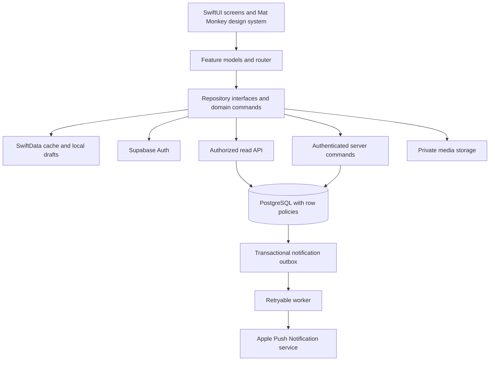

# Mat Monkey v2 — architecture and implementation draft

Prepared November 1, 2026 (America/Los_Angeles).

Baseline: `tienmai56/Calculated-Reps`, branch `claude/great-pascal-iw1wg3`, commit `6314b3e978cc57296292b8b69300e8a65f866f8b`. This is a planning document; no application or infrastructure changes are included.

## 1. Recommendation and scope

Build an iOS-first SwiftUI application using the prototype's existing design system, with Supabase Auth, PostgreSQL, private object storage, and a small server command layer. Use SwiftData for account-scoped local caching and durable drafts. PostgreSQL owns shared truth; the phone owns presentation state and unfinished drafts.

Assumptions: a small team, an initial community-sized launch, iOS 17+ as in the native prototype, and an update to the existing app. `DESIGN.md` also describes Android; this draft defers its client implementation while keeping server contracts platform-independent. If Android must launch simultaneously, revisit client staffing and framework choice before phase 1. Raising the old app's iOS 13 floor is a product decision, not an automatic migration requirement.

The social MVP includes Activity, Training, Friends, Profile, session planning and joining, completion and shared posts, reactions/comments, QR friendships, weekly streaks, and notifications. Preserve existing notebooks privately through an archive and export path. Do not expand v2 into new performance analytics, messaging, public discovery, or leaderboards.

## 2. What the code establishes

| Evidence | Consequence |
| --- | --- |
| `Prototypes/README.md`: separate SwiftUI target, iOS 17+, in-memory sample data | Reuse the UI; persistence and shared behavior still need implementation. |
| `Prototypes/MatMind/App/AppModel.swift`: one observable model owns navigation, arrays, mutations, and simulated timers | Extract navigation and feature state; replace demo mutations with real repositories and commands. |
| `Prototypes/MatMind/App/Models.swift`: dates and relative times are strings; likes/comments are embedded arrays | Introduce typed timestamps, stable identifiers, normalized relationships, and paginated queries. |
| `DESIGN.md`, section 8–9, and `ui_kits/app/flows.html`: three journeys and explicit product rules | Treat these rules as server invariants, not just disabled buttons. |
| Existing `NotebookPersistence.swift`: account-scoped JSON and image directories | Add a verified migration and preserve original files. |
| Existing `AuthService.swift`: native providers return a local `UserAccount` | A local account object is not a verified backend session; introduce server authentication. |
| Existing `TrainingModels.swift`: goals, tasks, plans, reflections, notes, bounties, competitions | These are private legacy records, not a ready-made social schema. |

Source review only: the prototype was not run or visually validated for this draft. The local checkout has existing edits and differs from the remote baseline; implementation must inventory and preserve those changes before integrating.

## 3. Architecture



**Client.** Keep SwiftUI and the `MM` component/token system. Use `@MainActor @Observable` feature models for loading, validation, errors, and optimistic UI. A lightweight router owns navigation and deep-link routing. Repositories hide DTOs, local persistence, and network clients. Domain values contain no SwiftUI colors, image views, or formatted date labels.

**Backend.** Start with one managed relational backend and one command layer. Use SQL migrations for schema, grants, row policies, functions, and indexes. Authorized read APIs can expose carefully scoped queries. Multi-record writes go through transactional PostgreSQL functions. Edge Functions handle external integrations, signed media workflows where needed, and APNs delivery; a sequence of unrelated HTTP writes is not a database transaction.

**Authentication.** Exchange Apple/Google credentials for a backend session with token verification and nonce handling. Use the backend user UUID everywhere. Store refresh credentials in Keychain, keep email in private identity/account data, and separate profile editing from changing a verified email. Do not trust client-submitted user IDs or merge accounts solely on matching email. Supabase documents [native Apple sign-in](https://supabase.com/docs/guides/auth/social-sign-in/auth-apple).

**Authorization.** Enforce reads through PostgreSQL row-level security and apply equivalent checks inside commands. Restrict executable functions and table writes so clients cannot bypass transitions. Privileged functions must have an explicit caller check, controlled search path, and narrowly scoped grants. Keep administrative credentials off devices. See [Supabase row-level security](https://supabase.com/docs/guides/database/postgres/row-level-security).

**Live updates.** Ship pull-to-refresh and foreground revalidation first. Add scoped realtime subscriptions for visible sessions and notifications after correctness is established. Realtime events invalidate/refetch canonical records; they are not the only recovery mechanism.

Suggested layout:

```text
MatMind/
  App/                 # composition, session lifecycle, router
  DesignSystem/        # prototype tokens, components, patterns
  Domain/              # typed models, rules, repository protocols
  Data/                # API DTOs, repositories, local cache, migration
  Features/            # Activity, Training, Create, Complete, Friends, Profile
  Services/            # photos, QR, deep links, notifications
  LegacyArchive/       # private notebook reader and export
supabase/
  migrations/
  functions/
  tests/
```

## 4. Data storage design

### Cloud PostgreSQL

Use UUID primary keys for new entities, foreign keys, server timestamps, bounded text fields, and explicit status values. Keep provider identities in managed auth. Persist instants as `timestamptz`, plus IANA time-zone identifiers where calendar interpretation matters. Render labels such as “Tuesday” and “2 hours ago” on the client.

| Table | Essential fields and constraints |
| --- | --- |
| `profiles` | `id = auth user UUID`, display name, belt, stripes, home gym, avatar media ID. Validate rank/stripe combinations. No email. |
| `account_settings` | User ID, preferred time zone and notification preferences; owner-only access. |
| `gyms` | ID, name, time zone, optional location. Permit a session venue snapshot for gyms outside the initial list. |
| `friendships` | ID, canonical ordered user pair, stable hue, fixed streak time zone, connected time, active/removed status. Unique pair; no self-pairs. |
| `friend_tokens` | Owner, token hash, expiry, revoked time. QR redemption creates an instant friendship without an approval step. |
| `sessions` | Organizer, title, start instant, time zone, venue snapshot, optional gym ID, note, join mode, status, completed time, version. |
| `session_participants` | Session/user unique pair, RSVP, actual attendance, added-by and relevant timestamps. RSVP and attendance are separate fields. |
| `session_links` | Session, hashed token, expiry, revoked time. A join capability, not a post/media access grant. |
| `posts` | Unique session ID, author/organizer, caption, published time, version, deleted time. Only completed sessions qualify. |
| `post_participants` | Post/user unique pair, visible-tag state, removed time. One post referenced from many profiles. |
| `media_assets` | Owner, session/post or avatar association, private object key, type, size, checksum, processing state. |
| `post_likes` | Post/user composite primary key. |
| `comments` | ID, post, author, body, created/edited/deleted timestamps. |
| `friendship_session_credits` | Unique friendship/session pair, week start, completion timestamp; server-generated streak evidence. |
| `friendship_weeks` | Unique friendship/week start, qualifying count; rebuildable aggregate from credits. |
| `notifications` | Recipient, event type, actor, entity reference, created/read timestamps, dedupe key. |
| `device_tokens` | User, APNs token, environment, last seen; unique device registration. |
| `notification_outbox` | Event ID, payload reference, retry state, attempts, next attempt. Written with the originating mutation. |
| `command_receipts` | Actor, operation, idempotency key, request hash, stored result. Unique actor/operation/key. |
| `blocks`, `reports` | Blocking pair and report target/reason/status for social-content controls. |

Legacy records remain in a separate private archive for the MVP. A later opt-in notebook cloud feature should get owner-only tables, never feed tables.

Indexes: both friendship endpoints; session organizer/start; participant user/RSVP/session; posts `(published_at, id)`; comments `(post_id, created_at, id)`; likes by post; notification recipient/date and unread rows; credits by friendship/week; pending outbox work. Use cursor pagination with timestamp plus ID for feeds and comments. Add indexes based on measured query plans before introducing a feed fan-out service.

### Local phone storage

- SwiftData: account-scoped cached profiles, session summaries, posts, friendship summaries, notifications, editable drafts, and migration status. Selective cache replacement is sufficient initially; do not build bidirectional database replication.
- Application Support: durable draft photos and preserved notebook/archive attachments. Caches directory: downloaded thumbnails that can be recreated.
- Keychain: backend credentials and a narrowly scoped mapping to the previous local identity when needed.
- UserDefaults: non-sensitive display preferences only.

Offline MVP: browse previously cached content and edit/save drafts. Publishing, joining, QR redemption, and other shared mutations require a server connection. A failed submission preserves its draft and idempotency key for an explicit retry. Optimistic likes can roll back visibly on failure. Do not claim that invites were sent, publishing succeeded, or streaks increased before acknowledgement.

Cancel in-flight requests on sign-out/account changes and clear account caches and media previews. Retain private archive files without making them visible to a different signed-in account. Recheck authorization on refresh; previously downloaded content cannot be remotely erased from another person's device.

### Media

Use private avatar and session-photo buckets with an upload policy tied to the owner and draft/session. Compress and normalize orientation, strip location metadata, limit file size/type, and create bounded thumbnails. Store object keys in PostgreSQL rather than expiring URLs. Issue short-lived authorized download URLs or authenticated downloads. The storage policy must follow post/session visibility. Supabase supports [storage access policies](https://supabase.com/docs/guides/storage/security/access-control).

Uploads and PostgreSQL cannot commit atomically together: create a pending media record, upload, validate readiness, then reference it in the publishing transaction. Retry interrupted uploads and periodically delete abandoned pending assets. Revoke database access immediately on deletion and queue object cleanup; existing signed URLs expire after their short lifetime.

## 5. Product rules and command contracts

### Rules already specified by the prototype

1. Four tabs and a global planning action.
2. Join through an invitation, direct addition, or valid link; an authenticated Mat Monkey account is required. Reading a feed post is not permission to join.
3. Only the organizer publishes, edits, or deletes the session's shared post. Participants can remove their own profile tag.
4. One shared post per session, displayed through participant relationships.
5. QR creates a friendship instantly; no request/approval queue.
6. Weekly friendship streaks require both friends to have participated in at least one completed session during a Monday–Sunday week.

### Proposed decisions where the prototype is incomplete

- **Post audience:** participants and current friends of any currently tagged participant, excluding blocked relationships; no public feed. Session join-link visibility is independent. This union-of-friends audience should be explicit in the sharing UI because friends of partners can see a shared memory.
- **Week boundary:** a friendship has one fixed IANA time zone, initially the connecting user's chosen home time zone. Display it in streak details; travel and phone settings do not rewrite history. Week runs Monday 00:00 inclusive to next Monday 00:00 exclusive.
- **Completion:** organizer marks actual attendees; an RSVP alone never grants streak credit. All accepted attendees may count without a second confirmation, matching the prototype. Allow a participant to dispute/remove their attendance through an authorized correction command.
- **Deletion/tag removal:** deleting a post removes the memory from feeds and profiles but preserves the completed training event. Removing a profile tag alone does not change attendance. Correcting attendance recomputes affected streak credits. These distinctions should be explained near the relevant actions.
- **Backdated sessions:** allow past-session logging, validate that completion is not in the future, and calculate the affected historical weeks. Only grant credits for friendships active at the session time; do not automatically manufacture historical streaks when new friends connect.
- **Cancellation/editing:** organizer may edit or cancel planned sessions; after completion, use an explicit correction command rather than arbitrary edits to time/attendance. Removed/recreated friendships retain the canonical pair record, but inactive periods do not earn credit.

Lock these defaults during phase 1; they are recommendations, not features already implemented in the prototype.

### Command boundary

Expose typed commands such as `create_session`, `set_rsvp`, `manage_participants`, `join_session_with_token`, `redeem_friend_token`, `complete_and_publish`, `remove_post_tag`, `correct_attendance`, `delete_post`, `set_like`, and `add_comment`.

Each command derives the actor from the authenticated session, validates access, applies a legal transition, and returns canonical records. Use expected versions for conflicting edits and stable idempotency keys for retries. Prefer `set_like(true)` over a toggle, and return the original result for a repeated command with the same payload. Reject a reused key with a different payload.

For `complete_and_publish`, one database transaction must:

1. Lock the session and verify organizer, time, attendance, and media readiness.
2. Check the command receipt and existing unique post.
3. Mark completion and store actual attendees.
4. Insert the single shared post and visible participant links.
5. Generate credits for every eligible friendship pair among attendees, including pairs that do not involve the organizer.
6. Update affected weekly aggregates and write notification/outbox events.
7. Store and return the canonical result, including streak changes for celebration.

Compute current/best streaks from completed week buckets using server time. Multiple sessions in one week count as one week. A pending current week preserves the consecutive run ending last week; a missed closed week breaks it. Recalculate on historical edits and attendance correction. Never store a client-authoritative `streak += 1` counter.

## 6. Implementation sequence

| Step | Work and deliverables | Exit condition |
| --- | --- | --- |
| 1. Establish baseline | Pin remote commit, inventory local changes, run both app targets, capture journeys A/B/C. Confirm iOS floor, Android timing, audience, streak time zone, attendance and legacy archive behavior. Write short architecture decisions. | Reviewed behavior checklist and migration fixtures; existing work preserved. |
| 2. Build application boundaries | Create production composition root, router, feature models, repository protocols, typed IDs/dates and fake implementations. Reuse design tokens/components; keep seeds and simulated timers in previews/demo only. | Prototype journeys work through injected fakes; no production dependency on `SeedData`. |
| 3. Establish backend and identity | Separate development/staging/production environments. Add migrations, auth, profiles, private settings, row policies, command receipts and CI. Implement token lifecycle, account switching, secure credential storage and authenticated deep-link continuation. | Two accounts can sign in; unauthorized reads/writes fail at the API/database boundary. |
| 4. Ship private local storage and migration | Add SwiftData cache/drafts; implement legacy archive discovery, backups, decoder reuse, attachment copying and verification. Add archive viewer/export. | Existing notebooks survive upgrade, interrupted migration, repeated launch and account switching. |
| 5. Deliver friendships and QR | Implement QR generation, camera scan, token redemption, stable hue, friend profile and blocked/removed states. Use Universal Links with an owned domain and a minimal install/open landing page. | Two real accounts connect instantly; replay is idempotent and revoked/expired tokens fail safely. |
| 6. Deliver planning and RSVP | Implement gyms/venues, real date/time picker, invites, direct additions, join links, session detail, organizer management and cancellation. Persist unfinished session drafts. | Journey A works across two devices and survives relaunch; non-organizers cannot manage attendees. |
| 7. Deliver completion, media and streaks | Implement real PhotosPicker/camera permissions and upload pipeline, transactional completion/publishing, attendance and streak ledger. Replace simulated celebration values with command results. | Journeys B/C work; duplicate retries and concurrent publishing produce one post and correct credits. |
| 8. Deliver feed and interaction | Implement authorized paginated feed, post detail, profile activity, likes/comments, caption edit/delete and self-tag removal. Include block/report controls and loading/empty/error states. | All profiles reference the same post; visibility and removal rules pass multi-user checks. |
| 9. Deliver notifications and recovery | Add in-app notifications, transactional outbox worker, APNs, read state and deep links. Add foreground refresh, optional scoped realtime, retry UI and stale-cache reconciliation. | App restart or missed push recovers via server reads; worker retries do not duplicate in-app notifications. |
| 10. Prepare and release | Run regression, migration, accessibility, network-failure and device checks. Add account deletion/export, retention jobs, logs, alerts and backup-restore rehearsal. Test an upgrade signed with production identity before rollout. | TestFlight acceptance passes; staged rollout and operational recovery steps are documented. |

Dependencies: steps 2–4 establish the foundation; 5 precedes social invitations; 6 precedes 7; 7 precedes the real activity feed; notification delivery follows the underlying events. Implement each step as small reviewable PRs rather than a single target replacement.

## 7. Migration and release details

Keep the existing production bundle identifier and relevant signing/keychain entitlements for the update. Keep the prototype's identifier for demo builds. Bundle-ID continuity alone is not sufficient: verify sandbox paths, entitlements, database initialization, auth redirect configuration, and upgrade behavior on a device.

On first launch, locate each legacy account notebook, including `local`. Copy its JSON and attachments to a versioned backup. Decode with the existing migration logic; verify record counts, relationship references, and attachment checksums before marking completion. Persist a source fingerprint and migration version so interruption/relaunch cannot duplicate work. Leave originals intact until the migration is proven.

Retain goals, tasks, planned sessions, reflections, notes, bounties and competitions as private archive data. Do not automatically upload notebook images or turn old reflections into social posts. Legacy dates often represent normalized days, not trustworthy social event times; preserve that precision. A missing photo should produce a recoverable archive warning, not make the whole notebook disappear.

Link an old provider identity to a new backend account only after fresh authentication; never treat a locally stored account ID as proof of cloud ownership. For guest data, offer an explicit on-device claim/export path. A failed cloud sign-in must not lock users out of their private local archive.

After public writes begin, rollback should disable affected social features while preserving readable data, rather than reinstalling an older client with incompatible storage. Keep server migrations backward compatible during rollout and rehearse restoring both database and media references. Monitor command failures, upload failures, migration failures, query latency, outbox delay, storage growth and image egress.

## 8. Validation and effort

Prioritize tests of behavior that can lose data or grant access:

- Database authorization: organizer, participant, friend, stranger, removed friend, blocked user, link holder and expired-token cases. Test storage reads as well as SQL reads, including participant/organizer changes and privileged-function bypass attempts.
- Transaction/concurrency: repeated publish, simultaneous publish, repeated QR redemption, duplicate likes, media uploaded but publication failed, and worker crash/retry. Assert exactly one post and one friendship/session credit.
- Streaks: Monday/Sunday boundary, DST, different phone time zones, pending current week, missed closed week, several sessions in one week, historical logging, attendance correction and all eligible participant pairs.
- Migration: supported notebook versions, guest/provider accounts, malformed JSON, partial attachment loss, interrupted import, low storage and account isolation.
- Device journeys: A/B/C on two accounts, denied camera/photo permission, network loss, app termination during upload, expired auth, deep link after sign-in, VoiceOver, Dynamic Type and reduced motion.

Planning estimate: approximately 8–12 engineering weeks for one experienced iOS engineer with backend experience, including TestFlight hardening, assuming the current UI is reusable and scope stays fixed. Android, substantial legacy-feature redesign, moderation tooling beyond basic reporting, or full offline mutation sync would require separate estimates. Re-estimate after steps 1–3 expose auth, migration, and infrastructure constraints.

## 9. Source references

- [Pinned prototype README](https://github.com/tienmai56/Calculated-Reps/blob/6314b3e978cc57296292b8b69300e8a65f866f8b/Prototypes/README.md)
- [Product specification](https://github.com/tienmai56/Calculated-Reps/blob/6314b3e978cc57296292b8b69300e8a65f866f8b/DESIGN.md)
- [Journey rules](https://github.com/tienmai56/Calculated-Reps/blob/6314b3e978cc57296292b8b69300e8a65f866f8b/ui_kits/app/flows.html)
- [Prototype application state and actions](https://github.com/tienmai56/Calculated-Reps/blob/6314b3e978cc57296292b8b69300e8a65f866f8b/Prototypes/MatMind/App/AppModel.swift)
- [Prototype models](https://github.com/tienmai56/Calculated-Reps/blob/6314b3e978cc57296292b8b69300e8a65f866f8b/Prototypes/MatMind/App/Models.swift)
- [Legacy persistence](https://github.com/tienmai56/Calculated-Reps/blob/6314b3e978cc57296292b8b69300e8a65f866f8b/IntentionalTrainingNotes/Core/Persistence/NotebookPersistence.swift)
- [Legacy training models](https://github.com/tienmai56/Calculated-Reps/blob/6314b3e978cc57296292b8b69300e8a65f866f8b/IntentionalTrainingNotes/Core/Models/TrainingModels.swift)
- [Legacy authentication](https://github.com/tienmai56/Calculated-Reps/blob/6314b3e978cc57296292b8b69300e8a65f866f8b/IntentionalTrainingNotes/Core/Services/AuthService.swift)
