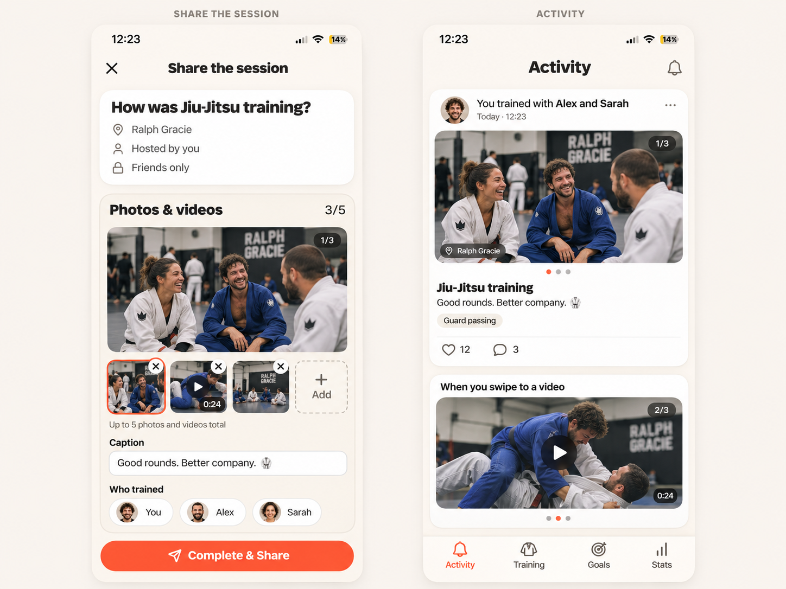

# Session photo/video gallery

The host composer supports five photos and videos combined in selection order. This extends session-backed sharing; a caption alone still works. Guest single-photo contributions stay separate and are never included in a host's post automatically.

The image is a design proposal. The extra video card illustrates another carousel slide, not a second feed post.

## Behavior

- Large preview, thumbnails, per-item Remove, Add until five, and a used/limit count. Library selection accepts mixed media in order. The existing camera adds a photo.
- JPEG photos are normalized as before. MP4/MOV/M4V videos are limited to 50 MB each, with the same cap enforced by private storage.
- Saving finalizes the complete ordered selection atomically, without publishing or confirming attendance. Retry retains selected files and reuses successful uploads. Publishing stays disabled during loading/saving or after a failed save.
- Activity and post detail share the carousel. One item hides its counter/dots; caption-only posts have no empty media block. Videos show posters, durations and play on tap in a dismissible native player.
- Published galleries keep their own asset IDs. Changing saved session media cannot change a published memory. Saved session galleries are visible only to hosts/accepted guests; published slides all follow existing post access, including blocks.
- The migration exposes an optional snapshot capability. Until deployed, library selection remains image-only with a single slot. Old caches and posts continue to decode.

## Rollout and validation

Apply `20261107175852_session_media_gallery.sql` before shipping the updated iOS build. No hosted database changes are made by this PR. The private session bucket accepts JPEG/MP4/MOV/M4V up to 50 MB; confirm the project's global storage cap is at least 50 MB.

The database suite includes limit, duplicate, ownership, cross-session, pending-upload, order/retry, visibility, direct post hydration and block checks. XCTest covers ordered mixed selections, invalid sixth/duplicate items, caption-only publishing, session/post independence, legacy NULL selection, file-extension preservation and sign-out cleanup. PR CI runs native build/archive/XCTest and captures composer/Activity with three sample photos as `session-media-native`.

Manual native acceptance:

1. Add two photos and three videos in alternating order. Preview each thumbnail, play a video, dismiss, remove one item, add another. At five, Add is absent and the picker cannot add a sixth. Check VoiceOver, large type and narrow screens.
2. Close/reopen the composer and relaunch. The saved host selection keeps its order. Accepted guests can view all saved media; pending/declined/blocked users cannot.
3. Disconnect during upload/save, retry and publish: files remain selected, failed saves block publishing and no duplicate post is created. Switch accounts during a request: no result or media leaks into the new account.
4. Publish a photo-first and video-first gallery. Swipe all slides in Activity and memory detail; tap to play and confirm playback stops on dismissal. Likes/comments apply to the whole memory. Check profile Gallery thumbnails for a video cover.
5. Publish one photo, one video, and a caption-only post. Single items have no pagination; caption-only posts have no placeholder. Verify completion, attendance and notifications still follow the existing quick-log regression guide.
